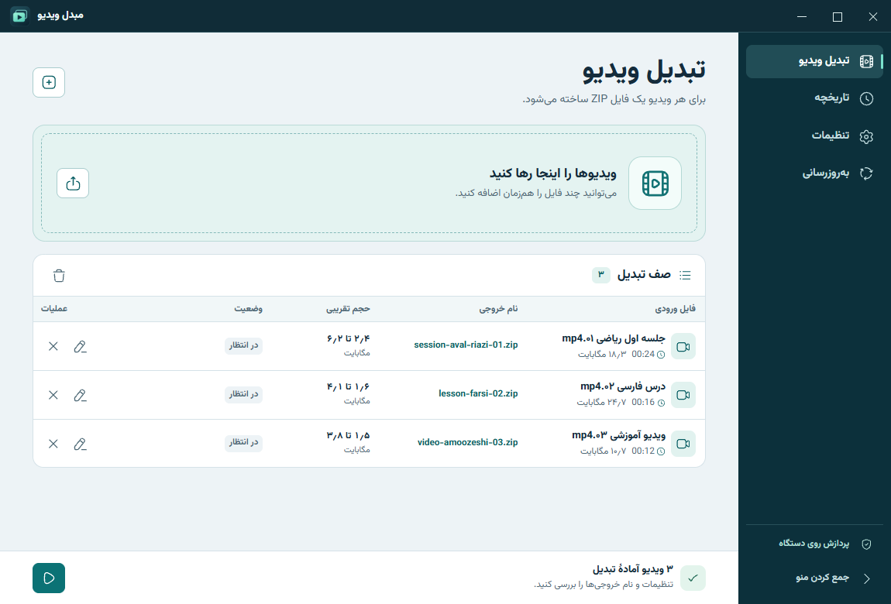

# مبدل ویدیو برای ویندوز

ویدیوها را به‌صورت دسته‌ای روی دستگاه تبدیل کنید و برای هر ویدیو یک ZIP جدا بگیرید. برنامه رابط فارسی و انگلیسی دارد و از HLS رمزگذاری‌شده، MP4 و WebM پشتیبانی می‌کند.

[دانلود برای ویندوز ۶۴ بیتی](https://github.com/a-nahvi/video-converter-releases/releases/latest) · [English](README.md) · [گزارش مشکل](https://github.com/a-nahvi/video-converter-releases/issues/new/choose)

## نصب و ارتقا

۱. از بخش **Assets** در صفحهٔ آخرین انتشار، فایل `VideoConverter-<version>-windows-x64-setup.exe` را دریافت کنید. [آخرین انتشار](https://github.com/a-nahvi/video-converter-releases/releases/latest)

۲. برای نصب تازه، در مرحلهٔ **Choose Install Location** پوشهٔ نصب را انتخاب کنید. برای ارتقا، ابتدا برنامه را ببندید و نصب‌کننده را اجرا کنید تا نسخهٔ موجود در همان مسیر ارتقا پیدا کند.

۳. **Video Converter** را از منوی Start باز کنید. موتور تبدیل همراه برنامه نصب می‌شود. اگر WebView2 روی دستگاه نباشد، نصب‌کننده آن را دریافت می‌کند.

## تبدیل ویدیو

۱. فایل‌ها را روی برنامه رها کنید یا با انتخاب‌گر فایل به صف اضافه کنید.

۲. در **تنظیمات**، قالب، کیفیت، وضوح تصویر و مسیر ذخیره را انتخاب کنید. صف، بازهٔ تخمینی حجم خروجی هر فایل را پیش از تبدیل نشان می‌دهد.

۳. در صورت نیاز نام پیشنهادی فینگلیش را در صف ویرایش کنید و تبدیل را شروع کنید. از **تاریخچه** می‌توانید پخش را باز کنید، ZIP را در File Explorer پیدا کنید یا رکورد تاریخچه را حذف کنید.

پیش‌فرض‌ها **HLS**، قطعه‌های **۱۰ ثانیه‌ای**، رمزگذاری **AES-128** و حداکثر عرض **۱۰۲۴ پیکسل** هستند. نسبت تصویر حفظ می‌شود و نام فینگلیش از ابتدا فعال است. برای نمونه، ZIP با نام `session-01.zip` شامل `playlist.m3u8`، قطعه‌های `.ts` و کلید `session-01.key` است. برای پخش یا انتشار HLS، فایل‌های ZIP را استخراج کنید و کنار هم نگه دارید.

اگر مسیر دیگری انتخاب نکنید، ZIP قالب HLS در `output_hls` و ZIP قالب MP4 یا WebM در `output_video` کنار ویدیوی ورودی ذخیره می‌شود.

## به‌روزرسانی

از **۱٫۶٫۰**، برنامه هنگام اجرا و هر شش ساعت به‌روزرسانی‌ها را از انتشار عمومی GitHub بررسی می‌کند. دریافت نسخه به حساب یا توکن GitHub نیاز ندارد. بعد از بررسی امضای نصب‌کننده، وقتی کار ناتمامی در صف نباشد برنامه به‌روزرسانی می‌شود. اگر نسخهٔ قبلی توکن می‌خواهد، نصب‌کنندهٔ جدید را یک‌بار اجرا کنید. [تاریخچهٔ نسخه‌ها](https://github.com/a-nahvi/video-converter-releases/releases)

## زبان برنامه

در **تنظیمات ← زبان برنامه** فارسی را برای چیدمان راست‌چین یا English را برای چیدمان چپ‌چین انتخاب کنید. تغییر همان لحظه اعمال می‌شود و برای اجرای بعدی ذخیره می‌شود.

## پشتیبانی

برای گزارش مشکل، شمارهٔ نسخه را از بخش **به‌روزرسانی** بردارید و مراحل تکرار مشکل را بنویسید. می‌توانید فارسی یا انگلیسی بنویسید. [ثبت گزارش یا پیشنهاد](https://github.com/a-nahvi/video-converter-releases/issues/new/choose)

## سورس و مجوز

کد مبدل با مجوز MIT منتشر می‌شود. برای ساخت از سورس، آیکن سیستمی در همان دستگاه ایجاد می‌شود و دکمه‌ها برچسب متنی دارند. [دستور ساخت](README.md#build-from-source) · [مجوز MIT](LICENSE)

