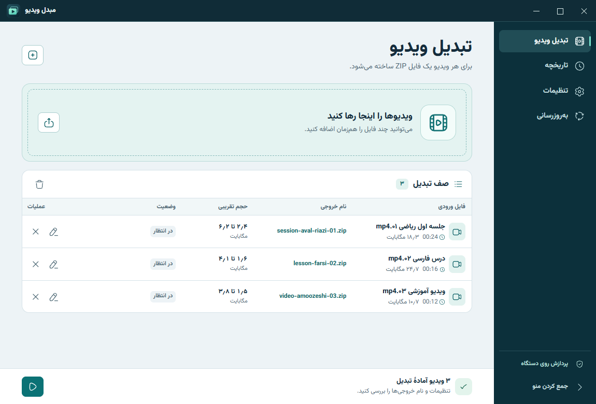

<div align="center">
  <h1>Video Converter</h1>
  <p>Batch video conversion for Windows with Persian and English interfaces. Create encrypted HLS packages or MP4 and WebM archives on your device.</p>
  <p><a href="https://github.com/a-nahvi/video-converter-releases/releases/latest"><strong>Download for Windows x64</strong></a> · <a href="README.fa.md">راهنمای فارسی</a> · <a href="https://github.com/a-nahvi/video-converter-releases/issues/new/choose">Report an issue</a></p>
</div>



## Install or upgrade

1. Open the [latest release](https://github.com/a-nahvi/video-converter-releases/releases/latest) and download `VideoConverter-<version>-windows-x64-setup.exe` under **Assets**.
2. Run the installer. For a new installation, select a folder in **Choose Install Location**. When upgrading, close the app and run the installer to update the existing installation in place.
3. Open **Video Converter** from the Start menu. FFmpeg and FFprobe are bundled. Setup downloads Microsoft Edge WebView2 if it is missing.

## Convert a batch

1. Drop videos into the app or add them with the file picker.
2. In **Settings** (تنظیمات), choose the output format, quality, resolution and destination. The queue shows an estimated size range for each output before you start.
3. Review or edit the suggested Finglish filenames. Start the batch, then use **History** (تاریخچه) to play the result, locate its ZIP in File Explorer or remove the history entry.

## App language

In **Settings → App language** (تنظیمات ← زبان برنامه), choose English for a left-to-right layout or فارسی for a right-to-left layout. The app applies the change immediately and remembers it when you reopen it.

| Output | Contents of each ZIP | Default destination beside the input |
| --- | --- | --- |
| HLS | `playlist.m3u8`, `.ts` segments and a `.key` file when AES-128 is on | `output_hls` |
| MP4 | H.264 video with AAC audio when present | `output_video` |
| WebM | VP9 video with Opus audio when present | `output_video` |

HLS is selected by default, with 10-second segments, AES-128 encryption and a maximum width of 1024 px. The app keeps the original aspect ratio. For `session-01.zip`, the encryption key is named `session-01.key`. The playlist references that key by its relative path. Extract and keep the HLS files together for playback or hosting.

## Updates and local processing

Starting with **1.6.0**, the app checks the public GitHub Releases page at launch and every six hours while open. Downloads require no GitHub account or token. The app verifies the installer signature and installs the update when the conversion queue is idle. If your earlier version asks for a GitHub token, run the latest installer once to migrate. [Release history](https://github.com/a-nahvi/video-converter-releases/releases)

Conversion, filename transliteration, playback and history run on your device. The updater connects to GitHub over HTTPS. Video Converter is built with Rust and Tauri and uses FFmpeg for encoding. Bundled libraries and FFmpeg source information are listed in the [third-party notices](docs/third-party.md).

## Build from source

Use Windows x64, PowerShell 7, the Rust MSVC toolchain, Visual Studio Build Tools with Desktop development with C++, WebView2 and Tauri CLI 2. Place FFmpeg and FFprobe on your `PATH` to convert videos in a development build.

```powershell
.\desktop\installer\prepare-development.ps1
Set-Location desktop/src-tauri
cargo test --locked
cargo tauri build --no-bundle --ci
```

The development script creates the standard Windows app icon locally. Development builds use text labels for controls. See the [packaging guide](desktop/installer/README.md) for installer build and release details.

## License

The original project code is available under the [MIT License](LICENSE). Bundled components retain their own [licenses](docs/third-party.md).

## Support

Use GitHub Issues to report a problem or request a feature in Persian or English. Include the app version from **Updates** (به‌روزرسانی) and the steps to reproduce the problem. [Open an issue](https://github.com/a-nahvi/video-converter-releases/issues/new/choose)
